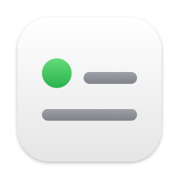

<p align="center"></p>

<h1 align="center">Dot</h1>

<p align="center">A quiet writing helper for macOS. It underlines typos as you type in any app or website,<br>and rewrites a message with your own Claude account when you ask.</p>

---

Dot stays out of the way: no sidebar, no score, no upsell. A small dot appears in the corner of your message only when something needs you.

## What it does

- **Instant underlines.** Misspelled words get a red underline while you type. English and Hebrew, also mixed in one message.
- **Hover to fix.** Point at an underlined word and click the fix.
- **The dot.** When there are mistakes, or you select text, a dot appears at the top-left of the text box. Click it for:
  - **Fix Everything**: accepts every underlined fix at once.
  - **Rephrase**: rewrites the message (or just the selected part) so it reads naturally.
  - **Make It Shorter**: cuts the message down and keeps the meaning.
- **Leaves code alone.** Links, @mentions, `#channels`, `:emoji:`, inline code and file paths are never marked.
- **Token counter.** The menu bar shows how many tokens Dot used today, this week and this month.

Rephrase and Make It Shorter show a preview first. Nothing changes until you click Replace.

## Requirements

- macOS 27 or later, Apple silicon.
- A Claude account with Claude Code: a Pro or Max plan, or a Team or Enterprise seat that includes Claude Code. Dot installs Claude Code for you if it's missing.
- Apple's Command Line Tools, which Dot is built with (the installer offers them if missing).

## Install

Paste this into Terminal:

```bash
curl -fsSL https://raw.githubusercontent.com/AmirTru/dot/main/install.sh | bash
```

It downloads Dot, builds it on your Mac (about a minute the first time), and opens it. If Apple's Command Line Tools aren't installed, it opens their installer first; run the command again when that finishes.

On first launch a welcome window walks you through two steps, and each one turns green when it's done:

1. **Allow Accessibility**, so Dot can see the text box you're typing in.
2. **Connect your Anthropic account.** Dot opens Anthropic's normal sign-in in your browser. Single sign-on (SSO) works if your company uses it.

Why build on your Mac instead of downloading an app: an app built on your own Mac isn't blocked by macOS, and a signing certificate made once on your Mac (kept in its own keychain under `~/Library/Application Support/Dot/signing`) keeps the Accessibility permission across updates.

## Update

Run the install command again. Your settings and permissions stay.

## Uninstall

```bash
curl -fsSL https://raw.githubusercontent.com/AmirTru/dot/main/install.sh | bash -s -- --uninstall
```

Then remove Dot from System Settings > Privacy & Security > Accessibility.

## Where it works

Everywhere you type: Slack, Mail, Notes, and any website in Safari, Chrome (and Arc, Edge, Brave, Dia), Firefox or Zen. Slack needs one restart with accessibility on; the Slack banner offers it the first time you open Slack.

You choose where Dot stays out:

- **Don't Check in [app]** and **Don't Check on [site]** in the menu bar block the app or site you're in.
- **Blocked Sites & Apps…** shows both lists, so you can add or remove entries.
- Blocked from the start: password managers (1Password, Bitwarden, Apple Passwords), Keychain Access, terminals (Terminal, iTerm, Ghostty, Warp), and sign-in pages (Google, Apple, Microsoft, Atlassian, the 1Password and Bitwarden web vaults).
- A browser's address bar is never checked.

## Privacy: what leaves your Mac

- **Spelling underlines** come first from the macOS spell checker, on your Mac.
- **Sentences** you type (outside blocked apps and sites) are sent to Claude Haiku through your own Claude Code login, to catch mistakes the Mac misses (like there/their, and most Hebrew). Rephrase and Make It Shorter send the message, or the part you selected.
- **Never read:** password fields, anything typed while macOS secure input is on, blocked apps and sites, and the browser address bar.
- **Dot holds no secrets.** It never sees your password, API key or login token. Claude Code keeps the login in your Keychain; Dot only runs `claude` and reads its answer.
- **Claude runs with everything off:** no tools, no MCP servers, no files, no saved sessions. Text in a message can't make it do anything except return text, and a "fix" that adds links, mentions or new sentences is thrown away.
- **Your clipboard** is used for one paste and then put back. Passwords copied from a password manager are never put back, so their auto-clear still works.
- **Logs** (`~/Library/Logs/WritingHelper.log`) hold lengths and positions only, never your text.

## Develop

```bash
git clone https://github.com/AmirTru/dot.git && cd dot
scripts/build-app.sh                      # build and install ~/Applications/Dot.app
scripts/test.sh                           # all unit tests
git config core.hooksPath scripts/hooks   # run the tests before every commit
scripts/update.sh                         # pull, test, rebuild and restart
WH_LIVE=1 scripts/test.sh --filter Live   # a few real calls to Claude
WH_EVAL=1 scripts/test.sh --filter Eval   # the prompt evals (many real calls)
```

Code layout:

- `Sources/WritingCore`: everything that can be tested without a screen: word scanning, protected ranges, prompt text, the Claude process lane, diffing, token counts.
- `Sources/WritingHelper`: the app: accessibility, overlay, menus, the welcome window.
- `scripts/make-icon.swift` draws the app icon.

## Known limits

- Slack has to be started with accessibility on. After Slack restarts on its own (for an update), the banner offers to fix it.
- Code editors on the web (Google Docs, VS Code for the web, CodeMirror sites) draw their own text, so Dot skips them.
- In Chrome and other Chromium browsers, Dot turns on the accessibility mode that VoiceOver uses. Underlines can take 2–3 seconds to appear the first time, and some window managers animate Chrome's windows more slowly.
- Rewrites use Claude Haiku, which is fast and cheap but sometimes shortens less than you'd like.
- No signed download yet: Dot installs by building on your Mac.

## Credits

- The rewrite rules are adapted from [humanizer](https://github.com/blader/humanizer) by Siqi Chen (MIT).

## License

MIT. See [LICENSE](LICENSE).
